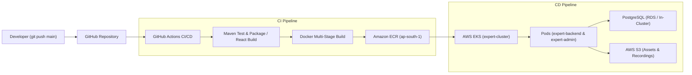

# ExpertApp Cloud & DevOps Enterprise Specification

> **MANDATORY SPECIFICATION**: This document defines the permanent, non-negotiable Cloud Infrastructure, DevOps tools, and CI/CD deployment pipeline for the ExpertApp platform. Do not ask for or redefine this stack.

---

## 1. Core Technology Stack Matrix

| Category | Technology | Purpose & Scope |
| :--- | :--- | :--- |
| **Containerization** | **Docker** | Multi-stage production container builds for `expert-backend` and `expert-admin`. |
| **Orchestration** | **Kubernetes** | Declarative state management, auto-healing, rolling zero-downtime updates via manifests in `k8s/`. |
| **Managed Cluster** | **AWS EKS** (Elastic Kubernetes Service) | Managed control plane & worker nodes running in AWS region `ap-south-1` under namespace `expert-platform`. |
| **Container Registry** | **Amazon ECR** (Elastic Container Registry) | Secure private registries for `expert-backend` and `expert-admin` tagged with git SHA and `latest`. |
| **Object Storage** | **AWS S3** (Simple Storage Service) | Scalable object storage for expert profile photos, voice bio audio clips, KYC docs, and call logs. |
| **Version Control** | **Git + GitHub** | Git branching strategy with protected `main` (production) and `develop` (staging) branches. |
| **CI/CD Pipeline** | **GitHub Actions** | Automated end-to-end pipelines (`.github/workflows/backend-ci.yml` & `admin-ci.yml`) triggering on push to `main`. |

---

## 2. Architecture & Deployment Workflow



---

## 3. GitHub Actions CI/CD Pipelines

### 3.1 Backend Workflow (`.github/workflows/backend-ci.yml`)
* **Trigger**: Push or PR to `main` with changes under `expert-backend/**`.
* **Jobs**:
  1. **Checkout & JDK Setup**: Java 17 Temurin with Maven cache.
  2. **Automated Testing**: Runs `mvn clean test` (JUnit 5 & Mockito).
  3. **Packaging**: Runs `mvn package -DskipTests`.
  4. **AWS Authentication**: Configures `aws-actions/configure-aws-credentials@v4` with regional endpoint `ap-south-1`.
  5. **ECR Login & Push**: Builds Docker image, tags with `${{ github.sha }}` and `latest`, then pushes to Amazon ECR.
  6. **EKS Zero-Downtime Rollout**:
     ```bash
     aws eks update-kubeconfig --name expert-cluster --region ap-south-1
     kubectl set image deployment/expert-backend backend=$ECR_REGISTRY/expert-backend:$IMAGE_TAG -n expert-platform
     kubectl rollout status deployment/expert-backend -n expert-platform
     ```

### 3.2 Admin Console Workflow (`.github/workflows/admin-ci.yml`)
* **Trigger**: Push or PR to `main` with changes under `expert-admin/**`.
* **Jobs**:
  1. **Checkout & Node Setup**: Node.js 18 with npm cache.
  2. **Dependencies & Build**: `npm ci` and `npm run build`.
  3. **Docker Build & Push**: Multi-stage Nginx container pushed to Amazon ECR `expert-admin`.
  4. **EKS Rollout**: Rolling deployment update to `deployment/expert-admin` in namespace `expert-platform`.

---

## 4. Kubernetes Manifests Specification (`k8s/`)

| File | Resource Types | Description |
| :--- | :--- | :--- |
| `k8s/configmap.yaml` | `ConfigMap` | Environment variables, database URLs, active profiles, and CORS domains. |
| `k8s/backend-deployment.yaml` | `Deployment`, `Service` | 2+ replicas for Spring Boot API, health probes (`/actuator/health`), port 8080. |
| `k8s/admin-deployment.yaml` | `Deployment`, `Service` | 2+ replicas for React Admin Nginx frontend, port 80. |
| `k8s/ingress.yaml` | `Ingress` (ALB / Nginx) | SSL/TLS termination, routing `/api` to backend and `/` to admin console. |

---

## 5. Required AWS Secrets & Variables

Configured in **GitHub Repository Settings -> Secrets and variables -> Actions**:

* `AWS_ACCESS_KEY_ID`: IAM user access key with ECR and EKS deployment permissions.
* `AWS_SECRET_ACCESS_KEY`: IAM user secret key.
* `AWS_REGION`: `ap-south-1` (Mumbai).
* `EKS_CLUSTER_NAME`: `expert-cluster`.
* `EKS_NAMESPACE`: `expert-platform`.
* `S3_BUCKET_NAME`: `expertapp-production-assets`.

---

## 6. Execution Command Reference

### Local Container Verification
```bash
# Build and run complete multi-container stack locally
docker compose up -d --build
```

### Manual EKS Verification via kubectl
```bash
# Authenticate to AWS EKS
aws eks update-kubeconfig --name expert-cluster --region ap-south-1

# View Pod status
kubectl get pods -n expert-platform

# View Deployment rollout status
kubectl get deployments -n expert-platform
kubectl get services -n expert-platform
kubectl get ingress -n expert-platform
```
